  

  
  
  
  
  

## Sobre mí

<table>
  <tr>
    <td width="70%" valign="top">
      
Construyo software <b>de principio a fin</b>: desde la arquitectura hasta el despliegue, y lo mantengo estable a medida que crece.

      

        
<b>Web y móvil</b>

         Interfaces y aplicaciones claras, pensadas para responder rápido en cualquier dispositivo.  
      

      

        
<b>Backend y APIs</b>

         Sistemas y APIs sólidos, con bases de datos bien diseñadas y pruebas.  
      

      

        
<b>DevOps y cloud</b>

         Servidores, contenedores, balanceo, escalado, monitoreo y observabilidad.  
      

      

        
<b>IA y automatización</b>

         Integración de modelos y servicios, y flujos que aceleran tareas.  
      

      <blockquote><b>Disponible</b> para colaborar en proyectos, startups y consultorías.</blockquote>
    </td>
    <td width="30%" align="center" valign="middle">
      
    </td>
  </tr>
</table>

## Proyectos destacados

<table>
  <tr>
    <td width="50%" valign="top">
      <a href="https://github.com/Freddy-system/file-editor-viewer"><b>File Editor &amp; Viewer</b></a> 
      Ve y edita archivos desde la terminal: Markdown con Mermaid, Graphviz y LaTeX, código resaltado e imágenes.  
      <code>Rust</code> <code>CLI</code>
    </td>
    <td width="50%" valign="top">
      <a href="https://github.com/Freddy-devs/zen-tab-sleep"><b>Zen Tab Sleep</b></a> 
      Extensión que suspende pestañas sin uso y libera RAM en Chrome, Brave y Edge, con reglas por página, sitio o ventana.  
      <code>JavaScript</code> <code>Extensión</code>
    </td>
  </tr>
  <tr>
    <td width="50%" valign="top">
      <a href="https://github.com/Freddy-devs/arch-zen-niri-dotfiles"><b>arch-zen-niri</b></a> 
      Un solo script convierte un Arch Linux recién instalado en un escritorio mínimo con linux-zen, niri y SDDM.  
      <code>Python</code> <code>Shell</code> <code>Linux</code>
    </td>
    <td width="50%" valign="top">
      <a href="https://github.com/Freddy-system/arbol-genealogico-laravel12"><b>Árbol genealógico API</b></a> 
      API para gestionar personas, ancestros, descendientes y parentescos.  
      <code>PHP</code> <code>Laravel 12</code> <code>REST</code>
    </td>
  </tr>
  <tr>
    <td width="50%" valign="top">
      <a href="https://github.com/Freddy-system/dark-pirate-sddm"><b>Dark Pirate SDDM</b></a> 
      Tema oscuro y configurable para la pantalla de inicio de sesión en Linux.  
      <code>QML</code> <code>Qt</code>
    </td>
    <td width="50%" valign="top">
      <a href="https://github.com/Freddy-system?tab=repositories"><b>Ver todos los repositorios</b></a> 
      Más proyectos, configuraciones de Linux y prácticas.
    </td>
  </tr>
</table>

## Tecnologías

<table>
  <tr>
    <td><b>Lenguajes</b></td>
    <td>
      
      
      
      
      
      
      
      
      
    </td>
  </tr>
  <tr>
    <td><b>Frontend y mobile</b></td>
    <td>
      
      
      
    </td>
  </tr>
  <tr>
    <td><b>Backend</b></td>
    <td>
      
      
      
      
    </td>
  </tr>
  <tr>
    <td><b>Bases de datos</b></td>
    <td>
      
      
      
    </td>
  </tr>
  <tr>
    <td><b>DevOps y herramientas</b></td>
    <td>
      
      
      
      
      
      
    </td>
  </tr>
</table>

## Actividad

  

<!-- 
 ## Mis redes sociales  

--- -->
